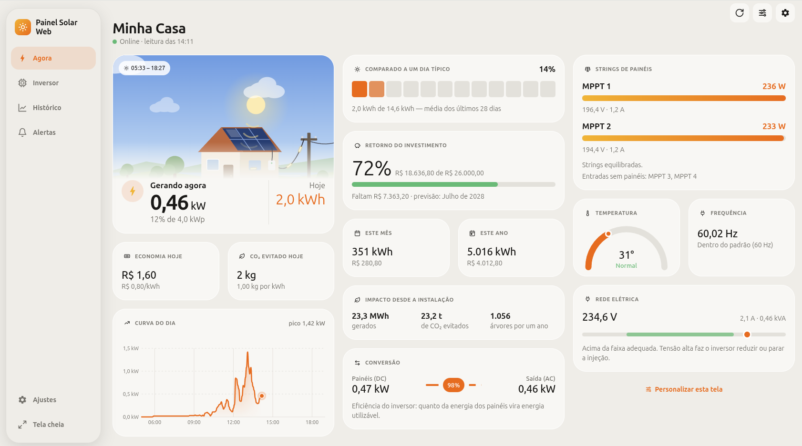

# Painel Solar Web · cliente web não oficial para usinas Renovigi

Acompanhe sua usina solar **Renovigi** pelo navegador, com a mesma conta do app
**RenoClient**. Os dados vêm da nuvem **ShineMonitor** (Eybond).

Versão web de Guilherme Wiszniewski, baseada no app Android
[renovigi-client](https://github.com/humbertocortezia/renovigi-client) de Humberto Cortezia.

> Projeto independente e não oficial, sem vínculo com Renovigi, Eybond ou ShineMonitor.
> A API não é documentada para terceiros e pode mudar sem aviso.



## Como rodar

Requisito: Docker.

```sh
docker compose up -d --build
```

Abra <http://localhost:9002>. Para usar outra porta: `PORT=9100 docker compose up -d --build`.
Para parar: `docker compose down`.

## Funcionalidades

- **Login** com o usuário/e-mail e a senha do RenoClient ou do portal ShineMonitor.
- **Modo demonstração**: usina fictícia, sem conta ("Ver demonstração" no login).
- **Agora**: card "Gerando agora" com cena animada do céu no horário real (nascer/pôr do sol pela
  localização da usina), potência atual, energia do dia, curva do dia, comparação
  com um dia típico, economia em R$, retorno do investimento, CO₂ evitado e último alerta.
  **Personalizável** (botão de ajustes deslizantes): escolha quais cards aparecem e em que
  ordem, inclusive cards do Inversor.
- **Inversor**: strings de painéis, eficiência DC→AC, temperatura, tensão e
  frequência da rede (faixa da ANEEL) e dados dos equipamentos.
- **Histórico**: dia (qualquer parâmetro do inversor, com comparação com ontem),
  semana, mês, ano e total.
- **Alertas**: alarmes dos últimos 12 meses traduzidos, com duração e explicação.
- **Ajustes**: nome da usina e tarifa (gravados na nuvem), calculadora de tarifa
  pela conta de luz, valor investido e tema claro/escuro.
- **Layout adaptável**: no celular, abas embaixo; em telas a partir de 1024 px
  (PC, TV), barra lateral, cards em colunas e botão de **tela cheia** para usar como painel.
- Atualização automática logo após cada envio do coletor (~5 min).

## Privacidade

Tudo fica só no navegador (`localStorage`). O contêiner apenas repassa as requisições
à ShineMonitor por HTTPS (o navegador não pode chamá-la direto) e não armazena nada.

- **Padrão:** a senha não é guardada. Fica só o token da sessão, e quando ele expira
  é preciso entrar de novo.
- **"Manter conectado"** (opcional no login): guarda também o SHA-1 da senha, para
  renovar a sessão sozinho. Para esta API, esse hash **vale tanto quanto a senha**:
  quem tiver acesso ao navegador pode usá-lo para entrar na sua conta. Use só em
  computador seu. Dá para apagá-lo em **Ajustes → Esquecer senha salva**.
- A página só executa código servido pelo próprio contêiner (Content-Security-Policy),
  o que protege o token contra scripts injetados.

## Segurança: só para uso local

Feito para rodar **na sua máquina ou na sua rede de casa**, via Docker. Não exponha à internet:

- Não há HTTPS nem login próprio do servidor: quem alcançar a porta abre o app e
  usa o contêiner como ponte para a ShineMonitor.
- Sem HTTPS, o usuário e o token de sessão trafegam sem criptografia entre o navegador
  e o contêiner. Quem interceptar o token pode usar a sua sessão, inclusive para alterar
  o nome e a tarifa da usina.
- Por padrão o app só aceita conexões do próprio computador (`127.0.0.1:9002`).
- Para abrir no celular ou em outro aparelho da rede de casa, rode
  `BIND=0.0.0.0 docker compose up -d --build`. Assim qualquer aparelho da rede acessa. Se o
  roteador, a nuvem ou o firewall liberarem essa porta, o app fica **exposto
  publicamente**. O Docker publica portas passando por cima de regras do `ufw`.
- Para acessar de fora de casa, use uma VPN (ex.: WireGuard, Tailscale) em vez de abrir a porta.

## Licença

[MIT](LICENSE) © 2026 Humberto Cortezia (app original) e Guilherme Wiszniewski (versão web)
