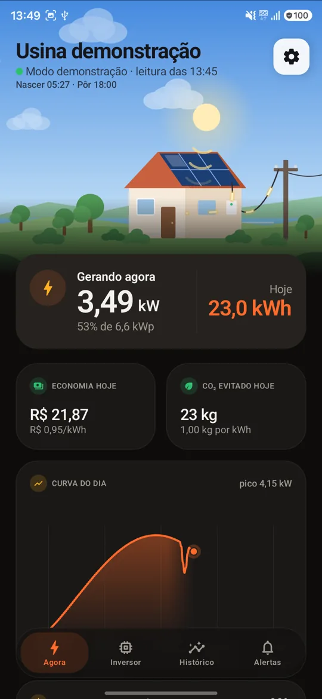
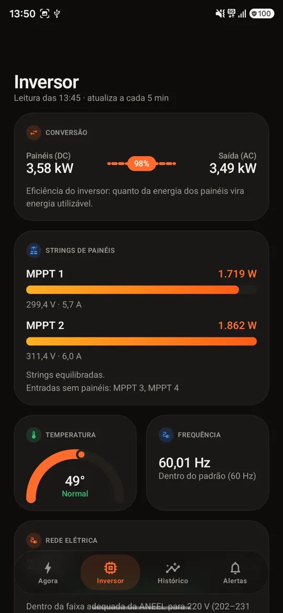
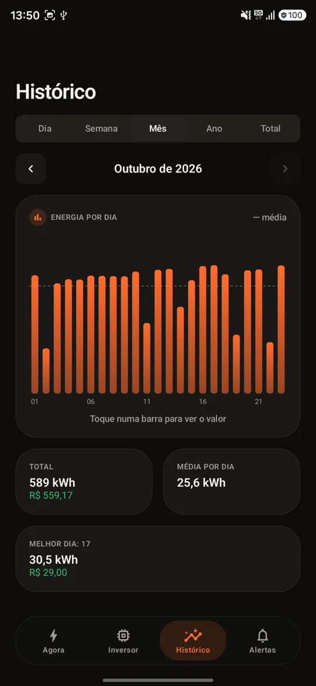
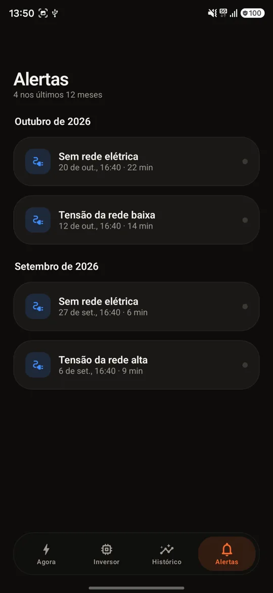
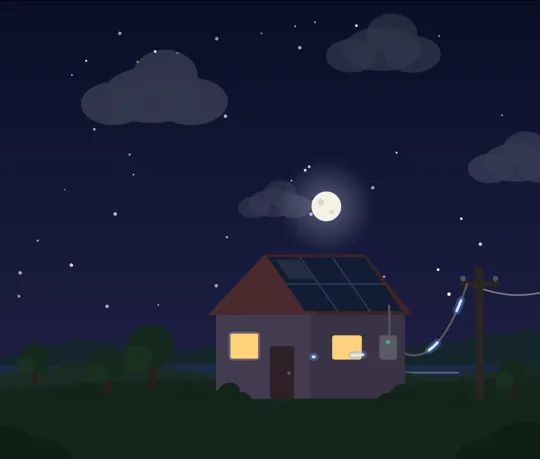
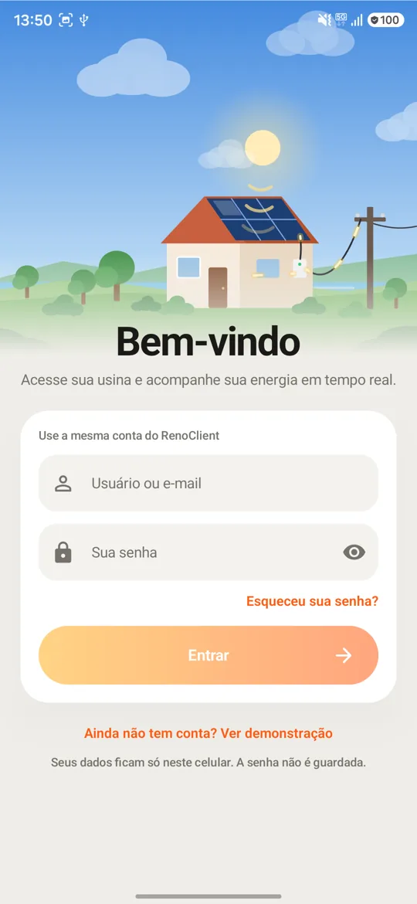
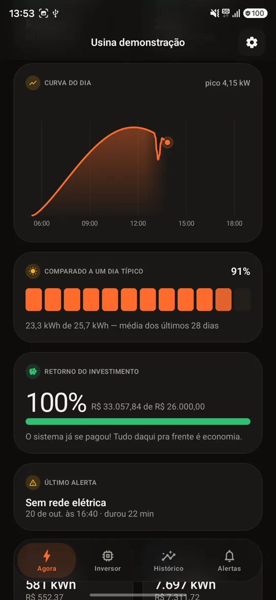
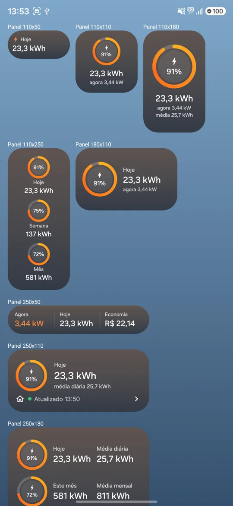
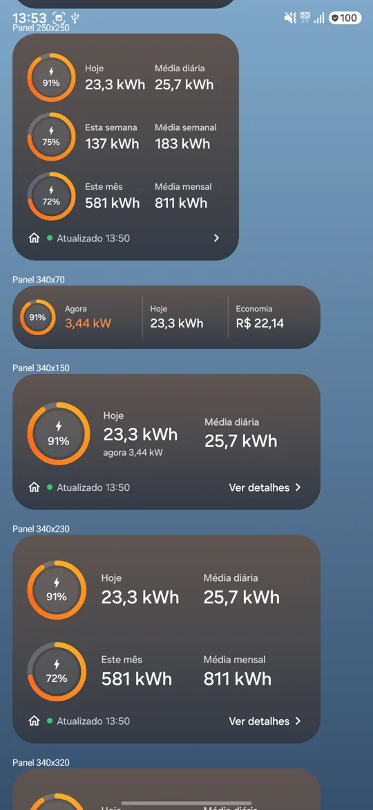
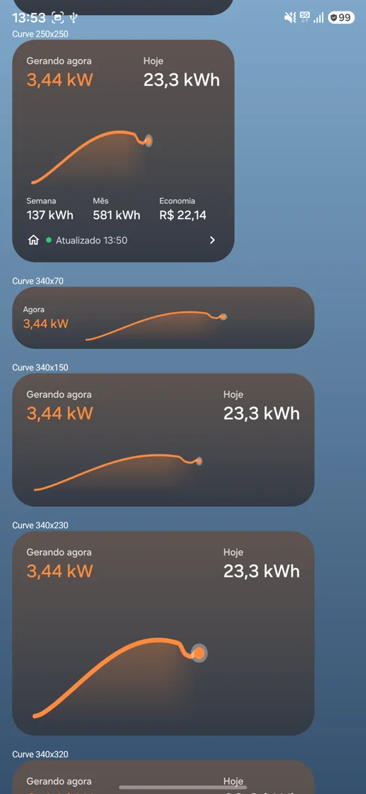

# Solar · cliente não oficial para usinas Renovigi

App Android para acompanhar a sua usina solar **Renovigi** (a que você vê no
app **RenoClient**), com visual moderno, animações e widgets para a tela inicial.
Ele lê os dados da mesma nuvem que o RenoClient usa (**ShineMonitor**, da Eybond),
com a sua própria conta.

> [!IMPORTANT]
> Projeto **independente e não oficial**. Não é afiliado, endossado nem mantido
> pela Renovigi, pela Eybond ou pela ShineMonitor. Os nomes são citados apenas
> para identificar com quais sistemas o app é compatível. A API usada não é
> documentada oficialmente para terceiros e pode mudar sem aviso. Use por sua
> conta e risco.

<p align="center">
  
  
  
  
</p>

## Recursos

- **Cena animada da usina (Lottie):** o céu acompanha o horário real, do
  amanhecer à noite estrelada, com nascer e pôr do sol calculados pela
  localização da usina. O sol manda "ondas" às placas, e a energia corre pelos
  cabos até a casa e a rede. À noite o fluxo se inverte (a casa consome da rede).
  Nuvens aparecem quando a geração está abaixo do esperado para céu limpo.
- **Agora:** potência atual, energia do dia, curva do dia, comparação com um dia
  típico, economia em R$, retorno do investimento, CO₂ evitado e último alerta.
- **Inversor:** cada string de painéis (tensão, corrente e potência), eficiência
  da conversão DC→AC, temperatura, tensão e frequência da rede (com a faixa
  adequada da ANEEL) e dados dos equipamentos.
- **Histórico:** dia (qualquer parâmetro do inversor, com comparação com ontem),
  semana (comparada com a anterior), mês, ano e total.
- **Alertas:** linha do tempo dos alarmes em português, com duração e explicação.
- **Ajustes:** nome da usina e tarifa (gravados na nuvem), calculadora de tarifa
  pela conta de luz, valor investido, tema claro ou escuro.
- **Modo demonstração:** conheça o app sem conta, com uma usina fictícia
  ("Ainda não tem conta? Ver demonstração", no login).
- **Visual:** Jetpack Compose + Material 3, vidro fosco (Haze), números e
  gráficos animados, tema claro e escuro, layout adaptado a tablets.

<p align="center">
  
  
  
</p>

## Widgets

Cinco widgets para a tela inicial, todos **redimensionáveis**: o layout muda
conforme o tamanho e mostra mais informação quanto mais espaço houver.

| Widget | Tamanho inicial | Conteúdo |
|---|---|---|
| Solar · Resumo | 4x4 | anéis de geração do dia, da semana e do mês contra as médias |
| Solar · Geração | 4x2 | anel do dia, hoje × média diária e potência atual |
| Solar · Hoje | 2x2 | anel do dia com kWh e potência atual |
| Solar · Faixa | 4x1 | agora · hoje · economia |
| Solar · Curva do dia | 4x2 | potência atual e a curva do dia (suavizada) |

O anel mostra quanto do período **típico** já foi atingido. Exemplo: "72%" no
mês significa que a usina já gerou 72% do que um mês costuma gerar.

<p align="center">
  
  
  
</p>

## Instalação

1. Baixe o APK na página de [Releases](../../releases).
2. Abra o arquivo no celular e permita "instalar apps de fontes desconhecidas".
3. Entre com o **mesmo usuário e senha do RenoClient** (ou do portal ShineMonitor).

Requer Android 10 ou superior.

### Privacidade

- A senha **não é guardada**. O app salva só o SHA-1 dela, que é o que a
  assinatura do login usa, e o token de sessão, cifrados com AES-GCM no Android Keystore.
- Os dados vão direto do celular para a nuvem ShineMonitor, por HTTPS. Não há
  nenhum servidor intermediário nem coleta de dados.

## Compilando

Requisitos: JDK 17+ (testado com o 21) e Android SDK (platform 37). O Android
Studio é opcional: dá para compilar só pelo terminal e editar em qualquer editor.

```sh
./gradlew :app:testDebugUnitTest   # testes (assinatura da API e cliente HTTP)
./gradlew :app:assembleDebug       # APK de debug
./gradlew :app:installDebug        # instala no celular conectado (depuração USB)
scripts/release.sh                 # APK de release em dist/
```

O release é assinado se existir `keystore/keystore.properties`:

```properties
storeFile=keystore/minha-chave.jks
storePassword=…
keyAlias=…
keyPassword=…
```

Sem esse arquivo, o APK de release sai sem assinatura.

### Ferramentas de desenvolvimento (só na build de debug)

| Comando | O que faz |
|---|---|
| `adb shell am start -n br.com.dhc.solar/.debug.WidgetGalleryActivity --es widget summary` | todos os tamanhos dos widgets numa tela (`--ez stress true` usa os textos mais longos possíveis) |
| `adb shell am start -n br.com.dhc.solar/.debug.ScenePreviewActivity --ef p 0.1` | a cena num horário qualquer (0 = meia-noite, 0.5 = meio-dia) |
| `adb shell am start -n br.com.dhc.solar/.debug.DemoToggleActivity --ez on true` | liga/desliga o modo demonstração sem sair da conta |
| `adb shell am start -n br.com.dhc.solar/.debug.ExplorerActivity` | grava respostas da API, mascaradas (ver [docs/API.md](docs/API.md)) |
| `scripts/probe.sh` | testa a API real com a sua conta pelo terminal |

## Arquitetura

```
app/src/main/java/br/com/dhc/solar/
├── data/
│   ├── remote/      cliente ShineMonitor (OkHttp + kotlinx.serialization), assinatura, DNS resiliente
│   ├── auth/        credenciais cifradas (Keystore) e sessão com renovação automática
│   ├── local/       cache do último snapshot e preferências (DataStore)
│   ├── demo/        usina fictícia do modo demonstração
│   └── repository/  monta o snapshot, histórico, alertas e gravações
├── domain/          modelos, cálculo do nascer/pôr do sol, alarmes traduzidos
├── ui/              Compose: abas, componentes, tema, cena animada
├── widget/          widgets Glance responsivos
└── work/            atualização em segundo plano (WorkManager)
tools/lottie/        gerador das animações Lottie da cena (Python)
```

- **Fluxo:** API → repositório → cache (DataStore) → telas e widgets. Os widgets
  nunca acessam a rede: só leem o cache.
- **Atualização:** com o app aberto, logo depois de cada envio do coletor
  (~5 min). Em segundo plano, a cada 15 min.
- **Animações:** as quatro animações Lottie (`sky_cycle`, `energy_flow`,
  `energy_import` e `clouds`) são geradas por
  [`tools/lottie/generate_scenes.py`](tools/lottie/generate_scenes.py). Para
  mudar a cena, edite o script e rode `python3 tools/lottie/generate_scenes.py`.
- **Integração com a nuvem:** detalhes em [docs/API.md](docs/API.md).

## Contribuindo

Contribuições são bem-vindas, principalmente testes com **outros modelos de
inversor** da Renovigi ou de marcas que usam a ShineMonitor. Veja
[CONTRIBUTING.md](CONTRIBUTING.md).

## Créditos

- [shinemonitor-api](https://github.com/davidsmfreire/shinemonitor-api), de
  David Freire: o mapeamento do protocolo de autenticação que serviu de ponto
  de partida (o código deste app foi escrito do zero).
- [Haze](https://github.com/chrisbanes/haze) (efeito de vidro fosco) e
  [Lottie](https://github.com/airbnb/lottie-android) (animações), ambos Apache 2.0.

## Licença

[MIT](LICENSE) © 2026 Humberto Cortezia

---

## English summary

**Solar** is an unofficial Android client for **Renovigi** solar plants, the ones
monitored by the RenoClient app. It talks directly to the **ShineMonitor**
(Eybond) cloud with your own account. Features:

- an animated plant scene that follows the real time of day;
- live inverter data (strings, efficiency, temperature, grid);
- history by day, week, month and year;
- translated alarms;
- server-side tariff editing;
- a demo mode;
- five resizable home-screen widgets.

Built with Kotlin, Jetpack Compose, Glance and Lottie. Not affiliated with
Renovigi, Eybond or ShineMonitor. The protocol notes are in
[docs/API.md](docs/API.md) (in Portuguese). MIT licensed.
